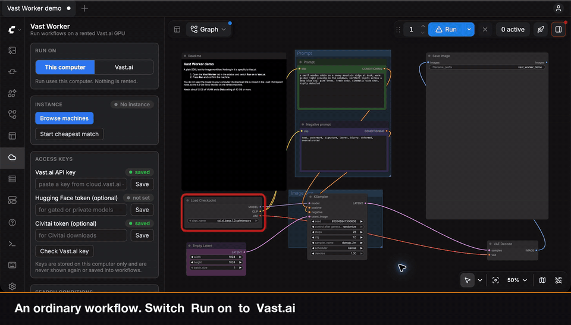

# ComfyUI-Vast-Worker

> **Everyone needs a GPU. No one needs it 24/7.**



*A real run, with the waiting fast-forwarded: 4 minutes to boot, 78 s to download a 6.5 GB model on the instance, 28 s to generate. Cost: less than one cent.*

A ComfyUI plugin made for Mac users: run your workflows on a rented [Vast.ai](https://vast.ai) GPU, from your own ComfyUI.

It was built and tested on macOS, for people whose machine is great for editing workflows and too slow for running them. Nothing in it is Mac-only, so it should work the same on Windows and Linux.

Your local ComfyUI stays the editor. Flip a switch in the sidebar and **Run** sends the whole workflow to a Vast.ai instance that this plugin rents, sets up and destroys for you. Models are downloaded on the instance, straight from Hugging Face or Civitai, so they never have to exist on your machine. Results come back into your local `output/` folder.

[繁體中文說明](README.zh-TW.md)

> **Status: alpha.**
> Everything below passes an end-to-end suite that runs a real ComfyUI as the "rented machine" behind a simulator of the Vast API. Against the real service, [`scripts/smoke_test.py`](#check-it-against-real-vastai) passed on 2026-11-10 (RTX 3060, `vastai/comfy:v0.44.0-cuda-12.9-py312`): renting, booting the official image, the token gate, installing the agent, running a workflow, a download on the instance, and the self-destroy switch. On 2026-11-11 a 150 MB upload from the local machine passed there, and so did a complete SDXL run from the sidebar: rent, download a 6.5 GB model from Hugging Face on the instance, generate, fetch the image (the recording above). Not yet confirmed on real hardware: downloads from Civitai, custom node packs, and long jobs. Vast changes its API and images over time, so run the smoke test yourself before relying on it; it costs a few cents.

## Why use it

Three things you do not have to do:

| | |
|---|---|
| **No changes to your workflow** | Open any workflow and press Run. There are no special nodes to add and nothing to rewire; the same workflow still runs locally when you switch back. |
| **Custom nodes sync themselves** | The node packs your workflow uses are installed on the rented machine automatically, at the version you have locally. |
| **Models download themselves** | Models are fetched on the rented machine from Hugging Face or Civitai. A model that only exists on your computer is uploaded for you. |

How that compares with pointing ComfyUI at a GPU machine you set up yourself, for example a second PC used as a worker:

| | This plugin | A worker machine you set up yourself |
|---|---|---|
| Workflow | Unchanged | Usually needs extra nodes or settings for remote execution |
| Custom nodes | Installed on the remote automatically | Installed and kept at the same version by hand |
| Models | Downloaded or uploaded automatically | Copied to the worker by hand |
| Hardware | Rented by the hour, any GPU size | Whatever you own, no hourly cost |
| Waiting | A new machine takes a few minutes to start | Ready whenever the worker is on |

A worker you own is the better choice when it is powerful enough and always on. This plugin is for when you want more GPU than you have, without maintaining a second ComfyUI.

## What you get

- **A run target switch.** Workflows run locally by default. Switch to *Vast.ai* and the same Run button uses the cloud GPU.
- **No Docker, no SSH, no manual setup.** The plugin rents the cheapest machine that matches your limits, boots Vast's official ComfyUI image and installs a small agent on it.
- **Models download on the instance.** From links embedded in the workflow, or from a model library you keep in the sidebar. Remote-only models show up in loader dropdowns while Vast mode is on.
- **Local files follow the workflow.** Reference images are uploaded automatically, and so is a model that only exists on your computer.
- **You choose the machines.** *Browse machines* opens a searchable list of Vast.ai offers, filtered by GPU, country, price and VRAM, and rents the one you pick. The same filters can be saved as the conditions for automatic renting. Part of a GPU name is enough: `4060` matches RTX 4060 and RTX 4060 Ti.
- **Custom nodes follow you.** Node packs your workflow uses are installed on the instance at the same git commit you have locally; packs without a git remote are uploaded.
- **It feels local.** Node highlighting, progress bars, live previews, the queue, history and cancel all work as usual.
- **Guard rails on cost.** A price ceiling, a confirmation before renting, automatic destroy when idle, and a dead-man's switch on the instance itself.

## How it works

```
Local ComfyUI (editor)                      Vast.ai instance (vastai/comfy image)
┌───────────────────────────┐               ┌──────────────────────────────┐
│ sidebar, dialogs          │               │ Caddy: HTTPS + access token  │
│ controller:               │── HTTPS ─────▶│ ComfyUI: runs the workflow   │
│  · swaps the prompt for   │◀─ progress, ──│ worker agent:                │
│    one proxy node         │   previews,   │  · downloads models          │
│  · rents / destroys       │   outputs     │  · installs custom nodes     │
│  · relays progress        │               │  · dead-man's switch         │
└────────────┬──────────────┘               └──────────────────────────────┘
             └── Vast REST API (search offers, rent, destroy)
```

When Vast mode is on, the plugin replaces the submitted graph with a single internal node before ComfyUI validates it. That node holds the original graph, runs it remotely, relays the remote events to your browser under the original node ids, and downloads every output file. Because validation only sees that one node, a model that is not on your disk is not an error.

## Install

```bash
cd ComfyUI/custom_nodes
git clone https://github.com/23daily/ComfyUI-Vast-Worker
```

Restart ComfyUI. There is nothing to `pip install`; the only dependency is `aiohttp`, which ComfyUI already has.

## Quick start

1. Open the **Vast Worker** tab in the sidebar (cloud icon).
2. Paste a Vast.ai API key ([cloud.vast.ai → Keys](https://cloud.vast.ai/manage-keys/)) and press **Save**, then **Check Vast.ai key**.
3. Set your limits under **Search conditions** — price ceiling, GPU models, countries — and press **Show matching offers** to see what you would get.
4. Switch **Run on** to **Vast.ai**.
5. Press **Run**. Pick a machine in the dialog and confirm. (Or rent one ahead of time with **Browse machines**.) The first run on a new machine takes a few minutes; later runs reuse it.

For a first run, try [`examples/vast_worker_demo.json`](examples/vast_worker_demo.json): a plain SDXL text-to-image workflow whose model link is stored in the workflow, so nothing has to be downloaded to your computer or added to the model library.

The instance is destroyed automatically after the idle time you set (15 minutes by default), or immediately with **Destroy instance**.

## Models

For every model file a workflow references, the plugin first looks for a download link, because a download inside the data centre is far faster than an upload from home. A model that has no link but exists on your computer is uploaded instead.

| Situation | What happens |
|---|---|
| The workflow embeds a link — official templates and many shared workflows do | Downloaded on the instance |
| The link is in the **Remote model library** in the sidebar | Downloaded on the instance. Paste the link once, choose the folder |
| No link, but the file is on your computer and Civitai has that exact file | Downloaded on the instance. The plugin looks the file up on Civitai by its hash (only the hash is sent) and remembers the link |
| No link, the file is on your computer, and Civitai does not know it (a LoRA you trained, for example) | Uploaded from your computer. Files over 2 GB ask first |
| A download fails (dead link, missing token) and the file is on your computer | Your local copy is uploaded instead |
| No link and no local file | A dialog asks for the link, and remembers it |

Gated or private Hugging Face repos need a Hugging Face token; Civitai downloads need a Civitai token. Both are set in the sidebar and are sent to the instance only for the download, only to the matching host.

A fresh instance starts empty, so models are downloaded again each time a new machine is rented. Data-centre connections make this much faster than a home download, but a large model set still adds minutes to a cold start.

Uploading can be switched to "ask me first" or "never" under **Behaviour** in the sidebar, where the size above which it always asks is also set. Reference images and other files in ComfyUI's `input` folder are always uploaded, since a workflow cannot run without them. Uploads are streamed and resume after a dropped connection.

### Using models from Civitai

Most LoRAs and checkpoints come from Civitai, so this is the path you will use most.

1. **Add your Civitai API key.** Create one in your Civitai account settings (search the settings for "API"), paste it into **Civitai token** under Access keys, and press Save. Many models, including most NSFW ones, cannot be downloaded without it.
2. **Models you already have locally need nothing more.** When a workflow uses a file from your `models` folder, the plugin recognises it on Civitai by its hash and downloads it on the instance.
3. **For a model you do not have locally**, add it to the Remote model library:
   - **Download link**: on the model page, pick the version, right-click the Download button and copy the link. It looks like `https://civitai.com/api/download/models/123456`.
   - **Folder**: `loras`, `checkpoints`, and so on.
   - **File name**: required, because a Civitai link does not contain one. Anything ending in `.safetensors` works.
4. **Pick it in the loader node.** While Run on is set to Vast.ai, library entries appear in the node's dropdown. Press `R` if the list has not refreshed.

A link cannot be pasted into a loader node directly: the node only offers file names, and the library is what connects a file name to its link.

## Custom nodes

Node packs must be installed locally, because the editor needs them. When the instance lacks a node type your workflow uses, the plugin installs the pack there and restarts the remote ComfyUI:

- a pack that is a git clone is cloned on the instance at your exact commit (uncommitted local edits are not carried over);
- anything else is packed and uploaded. Version-control data, caches and large binaries are left out, so weights a pack downloads for itself are fetched again on the instance.

`torch` and friends are filtered out of a pack's requirements so they cannot replace the instance's CUDA build.

## Keeping costs under control

- **Price ceiling.** Offers above your `$ / hour` limit are never rented.
- **Confirmation.** By default nothing is rented until you confirm the machine and price.
- **Idle destroy.** No job for the configured time → the instance is destroyed. Destroyed means deleted: billing stops entirely.
- **Dead-man's switch.** The agent on the instance destroys the instance if it has not heard from your ComfyUI for 10 minutes — for example after a crash, a closed laptop or a lost connection.
- **Restart-safe.** The instance id is saved; after a ComfyUI restart the plugin reconnects to it instead of renting another.
- **Leftover detection.** Instances carry a `comfyui-vast-worker-…` label. Any that this session is not tracking are listed in the sidebar with a Destroy button.
- **Failed boots are cleaned up.** A machine that does not come up is destroyed before the next offer is tried.

The sidebar shows the hourly price and an estimate of what the current instance has cost so far. The authoritative numbers are in your Vast.ai console.

## Settings

| Setting | Default | Meaning |
|---|---|---|
| Minimum VRAM | 24 GB | Smallest GPU to consider |
| Price limit | $1.00/h | Hard ceiling, storage included |
| GPU models | any | For example `RTX 4090, RTX 5090` |
| GPU generation | RTX 20 series or newer | `gpu.min_compute_cap` in `config.json` (750). The PyTorch build in Vast's image does not run on Pascal-era cards such as the Tesla P40, which are often the cheapest 24 GB offers |
| Minimum reliability | 0.98 | Vast's host reliability score |
| Minimum download | 200 Mbps | Slow hosts make model downloads slow |
| Disk | 80 GB | Must hold the image plus your models |
| Destroy after idle | 15 min | |
| Only in these countries | any | Pick from the countries that currently have offers |
| Never in these countries | CN | Regions where Hugging Face is unreachable |
| Local model with no link | upload automatically | Or "ask me first", or "never upload" |
| Ask before uploading over | 2000 MB | 0 = never ask |
| Docker image | auto | `auto` picks the `vastai/comfy` tag matching your ComfyUI version |
| Connection | HTTPS | See Security below |
| Ask before renting | on | |

Everything is stored under `ComfyUI/user/__vast_worker/`, a directory ComfyUI never serves over HTTP. API keys can also come from the environment: `VAST_API_KEY`, `HF_TOKEN`, `CIVITAI_TOKEN`.

## Security

- API keys are written to a `0600` file, are never sent back to the browser and are never saved into workflows or images. Login tokens for ComfyUI API nodes are not forwarded to the instance.
- Each instance gets a random access token. Vast's image rejects requests without it, and the agent checks it a second time.
- The connection uses HTTPS, but the instance's certificate is self-signed and **is not verified**. Traffic is encrypted against eavesdropping; it is not protected against an active man-in-the-middle. Do not send secrets you could not afford to rotate.
- You are running your workflow, and any custom node code it needs, on a machine owned by a Vast.ai host. Treat prompts, inputs and outputs accordingly.

## Limitations

- One instance, one workflow at a time. No parallel workers and no splitting of a graph between local and remote.
- A local model is uploaded at the speed of your own connection; for multi-gigabyte files a download link is the better route.
- No persistent storage between instances yet (Vast volumes are tied to one physical machine).
- Uncommitted edits to a git-cloned node pack are not synced.
- ComfyUI API nodes that need your comfy.org login do not work remotely.
- The remote ComfyUI version follows the image; if no image exists for your exact version the newest one is used, and core nodes may differ slightly.

## Check it against real Vast.ai

`scripts/smoke_test.py` rents the cheapest matching machine, checks the token gate, installs the agent, runs a tiny workflow, downloads a small public file on the instance, and destroys the machine — then confirms nothing with the plugin's label is left on your account.

```bash
export VAST_API_KEY=...            # read from the environment only
python scripts/smoke_test.py --dry-run                         # list offers and the estimated cost, rent nothing
python scripts/smoke_test.py --max-price 0.15 --self-destroy   # the real thing, including the dead-man's switch
```

If you use the `vastai` CLI, `--use-cli-key` reads the key it saved instead of the environment variable. The script asks before renting and prints a timing report. A cold start on a host that has to pull the image took about six and a half minutes in our run. If something about Vast's image differs from what this plugin expects, this is where it will show up; please open an issue with the output.

## Try it without a Vast.ai account

The repository includes a simulator of the Vast API that "rents" a second ComfyUI on your own machine:

```bash
python tests/e2e/run_e2e.py --serve --comfy-dir /path/to/ComfyUI
```

It prints a URL for a ComfyUI with the plugin already pointed at the simulator. Nothing is rented and no model is needed.

## Development

```bash
python -m unittest discover -s tests            # unit tests, no ComfyUI needed
python tests/e2e/run_e2e.py --comfy-dir /path/to/ComfyUI          # full end-to-end suite (~7 min)
python tests/e2e/run_e2e.py --comfy-dir /path/to/ComfyUI --quick  # skips the one-minute timer scenarios
```

Layout:

| Path | What it is |
|---|---|
| `vast_worker/` | The controller that runs inside your local ComfyUI |
| `agent/vast_worker_agent.py` | The single-file agent shipped to the instance |
| `web/vast_worker.js` | Sidebar and dialogs |
| `tests/sim/vast_sim.py` | Vast API + instance simulator |
| `scripts/smoke_test.py` | Real-Vast smoke test |

## License

GPL-3.0, the same as ComfyUI. Not affiliated with Vast.ai or Comfy Org.
