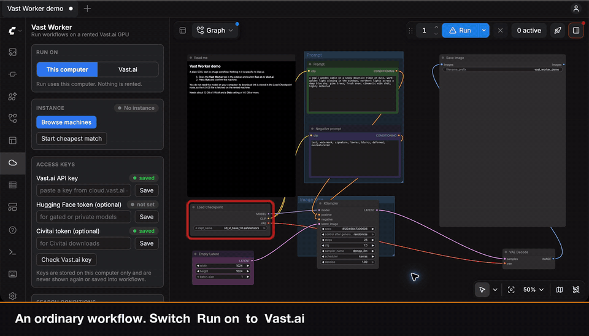

# ComfyUI-Vast-Worker

> **大家都需要 GPU，但沒人需要 GPU 24x7。**



*實際執行的畫面，等待的部分有快轉：開機 4 分鐘、在機器上下載 6.5 GB 模型 78 秒、生圖 28 秒。花費不到 1 美分。*

為 Mac 使用者做的 ComfyUI 外掛：在自己的 ComfyUI 裡，把 workflow 丟到租來的 [Vast.ai](https://vast.ai) GPU 上跑。

它是在 macOS 上開發和測試的，給那些電腦很適合編輯 workflow、但跑起來太慢的人用。程式裡沒有 Mac 專屬的部分，在 Windows 和 Linux 上應該也一樣能用。

本地 ComfyUI 只當編輯器。在側邊欄把開關切到 Vast.ai，按 **Run** 就會把整個 workflow 送到外掛替你租用、設定、用完銷毀的機器上執行。模型直接在那台機器上從 Hugging Face 或 Civitai 下載，不需要存在你的電腦裡。結果會回到本地的 `output/` 資料夾。

[English README](README.md)

> **狀態：alpha。**
> 下面的功能都通過了端對端測試：用一個 Vast API 模擬器，後面接一個真的 ComfyUI 當作「租來的機器」。對真實服務，[`scripts/smoke_test.py`](#用真的-vastai-驗證) 已在 2026-11-10 通過（RTX 3060、`vastai/comfy:v0.44.0-cuda-12.9-py312`）：租用、官方映像檔開機、token 驗證、安裝 agent、執行 workflow、在機器上下載、看門狗自毀。2026-11-11 另外通過了從本機上傳 150 MB 檔案的測試，以及從側邊欄操作的完整 SDXL 流程：租用、在機器上從 Hugging Face 下載 6.5 GB 模型、生圖、取回圖片（就是上面那段錄影）。尚未在真機確認的有：從 Civitai 下載、custom node 節點包、長時間工作。Vast 的 API 和映像檔會變動，正式使用前請自己跑一次煙霧測試，花費約幾美分。

## 為什麼用它

有三件事你不用自己做：

| | |
|---|---|
| **不用改 workflow** | 打開任何 workflow 直接按 Run。不需要加特殊節點，也不用重新接線；切回本地時，同一個 workflow 照樣能跑。 |
| **custom nodes 自動同步** | workflow 用到的節點包會自動裝到租來的機器上，版本和你本地的一致。 |
| **模型自動下載** | 模型直接在租來的機器上從 Hugging Face 或 Civitai 下載。只存在你電腦上的模型會自動上傳。 |

和「自己架一台 GPU 機器當 worker」（例如拿另一台電腦來用）相比：

| | 這個外掛 | 自己架的 worker 機器 |
|---|---|---|
| workflow | 不用改 | 通常要加遠端執行用的節點或設定 |
| custom nodes | 自動裝到遠端 | 要自己安裝，並手動保持版本一致 |
| 模型 | 自動下載或上傳 | 要自己複製到 worker 上 |
| 硬體 | 按小時租用，GPU 大小任選 | 用你現有的機器，沒有租金 |
| 等待 | 新機器要幾分鐘啟動 | worker 開著就能馬上用 |

如果你自己的機器夠力而且一直開著，自己架 worker 比較划算。這個外掛適合想用比手上更大的 GPU、又不想多維護一套 ComfyUI 的情況。

## 功能

- **執行目標開關**：預設在本地跑；切到 Vast.ai 後，同一個 Run 按鈕就用雲端 GPU。
- **不用 Docker、不用 SSH、不用手動設定**：外掛會租符合條件的最便宜機器，啟動 Vast 官方 ComfyUI 映像檔，並裝上一個小型 agent。
- **模型在遠端下載**：下載連結來自 workflow 內嵌資訊，或側邊欄的遠端模型庫。Vast 模式下，遠端模型會出現在 loader 的下拉選單。
- **custom nodes 自動同步**：workflow 用到的節點包會以你本地的同一個 git commit 裝到遠端；沒有 git remote 的則打包上傳。
- **操作感和本地一樣**：節點高亮、進度條、即時預覽、佇列、歷史、取消都照常運作。
- **自己挑機器**：**Browse machines** 會開啟可搜尋的 Vast.ai 報價清單，依 GPU、國家、價格、VRAM 篩選，選到就能直接租用；同一組篩選條件也能存成自動租用的條件。GPU 型號打一部分就行，`4060` 會匹配 RTX 4060 和 RTX 4060 Ti。
- **費用保護**：價格上限、租用前確認、閒置自動銷毀、機器端看門狗。

## 安裝

```bash
cd ComfyUI/custom_nodes
git clone https://github.com/23daily/ComfyUI-Vast-Worker
```

重啟 ComfyUI 即可，不需要另外 `pip install`。

## 快速開始

1. 打開側邊欄的 **Vast Worker**（雲朵圖示）。
2. 貼上 Vast.ai API key（[cloud.vast.ai → Keys](https://cloud.vast.ai/manage-keys/)），按 **Save**，再按 **Check Vast.ai key**。
3. 在 **Search conditions** 設定條件（價格上限、GPU 型號、國家），按 **Show matching offers** 看看會租到什麼。
4. 把 **Run on** 切到 **Vast.ai**。
5. 按 **Run**，在對話框選一台機器並確認。新機器第一次執行要等幾分鐘，之後會重複使用同一台。

第一次可以用 [`examples/vast_worker_demo.json`](examples/vast_worker_demo.json) 試跑：這是一個普通的 SDXL 文生圖 workflow，模型的下載連結存在 workflow 裡，不用先下載到你的電腦，也不用設定模型庫。

機器閒置超過設定時間（預設 15 分鐘）會自動銷毀，也可以按 **Destroy instance** 立刻銷毀。

## 模型

workflow 用到的每個模型檔，外掛會先找下載連結，因為在機房裡下載比從家裡上傳快很多。沒有連結、但你電腦上有的模型，則改為上傳。

| 情況 | 會發生什麼 |
|---|---|
| workflow 內嵌了連結（官方範本和許多分享的 workflow 都有） | 在機器上下載 |
| 連結在側邊欄的 **Remote model library** 裡 | 在機器上下載。貼一次連結、選資料夾即可 |
| 沒有連結，但檔案在你的電腦上，而且 Civitai 有一模一樣的檔案 | 在機器上下載。外掛會用檔案雜湊值到 Civitai 反查（只送出雜湊值），並記住連結 |
| 沒有連結，檔案在你的電腦上，Civitai 也查不到（例如自己訓練的 LoRA） | 從你的電腦上傳。超過 2 GB 會先問你 |
| 下載失敗（連結失效、缺 token），而檔案在你的電腦上 | 改為上傳你本地的那一份 |
| 沒有連結，本地也沒有 | 跳對話框請你貼連結，並記住 |

需要授權或私人的 Hugging Face repo 要設定 HF token；Civitai 下載要設定 Civitai token。兩者都只在下載時送到遠端，而且只送給對應的網站。

新租的機器是空的，所以每次換機器都要重新下載模型。機房頻寬比家用網路快很多，但模型多的話冷啟動仍會多幾分鐘。

上傳行為可以在側邊欄的 **Behaviour** 改成「先問我」或「永不上傳」，也可以調整超過多大就一定先問。參考圖片和 ComfyUI `input` 資料夾裡的其他檔案一律會上傳，因為沒有它們 workflow 跑不起來。上傳採串流方式，斷線後會從中斷處續傳。

### 使用 Civitai 的模型

大部分的 LoRA 和 checkpoint 都來自 Civitai，所以這是最常用到的流程。

1. **加入 Civitai API key**：在 Civitai 的帳號設定裡建立（在設定頁搜尋「API」），貼到 Access keys 的 **Civitai token** 後按 Save。很多模型（包含大多數 NSFW 模型）沒有它無法下載。
2. **本地已經有的模型不用再做任何事**：workflow 用到 `models` 資料夾裡的檔案時，外掛會用雜湊值在 Civitai 認出它，直接在機器上下載。
3. **本地沒有的模型**，加進 Remote model library：
   - **Download link**：在模型頁選好版本，對 Download 按鈕按右鍵複製連結，格式像 `https://civitai.com/api/download/models/123456`。
   - **Folder**：`loras`、`checkpoints` 等。
   - **File name**：必填，因為 Civitai 的連結裡沒有檔名。以 `.safetensors` 結尾即可。
4. **在 loader 節點上選它**：Run on 設為 Vast.ai 時，模型庫的檔名會出現在節點的下拉清單。清單沒更新的話按 `R`。

連結不能直接貼進 loader 節點：節點只能選檔名，模型庫的作用就是把檔名對應到下載連結。

## 費用保護

- **價格上限**：超過每小時上限的機器不會租。
- **租用前確認**：預設要你確認機器和價格後才租。
- **閒置銷毀**：超過設定時間沒有工作就銷毀機器。銷毀等於刪除，計費完全停止。
- **看門狗**：遠端 agent 若 10 分鐘沒收到你的 ComfyUI 的訊號（當機、闔上筆電、斷線），會自己銷毀機器。
- **重啟不丟機器**：機器 ID 會存檔，ComfyUI 重啟後會接回同一台，不會再租一台。
- **遺留機器偵測**：機器都帶有 `comfyui-vast-worker-…` 標籤，沒被目前工作階段追蹤的會列在側邊欄，附銷毀按鈕。
- **開機失敗會清掉**：起不來的機器會先銷毀，再試下一個報價。

側邊欄顯示的花費是估算值，實際金額以 Vast.ai 後台為準。

## 安全性

- API key 存在權限 `0600` 的檔案，不會回傳給瀏覽器，也不會寫進 workflow 或圖片。
- 每台機器有一組隨機存取 token，沒帶 token 的請求會被拒絕。
- 連線使用 HTTPS，但機器的憑證是自簽的，**不做驗證**：可防竊聽，無法防主動的中間人攻擊。
- 你的 workflow 和它需要的 custom node 程式碼，是在 Vast.ai 主機擁有者的機器上執行，請據此評估 prompt、輸入與輸出的敏感度。

## 限制

- 一次一台機器、一個 workflow；不支援多 worker 平行，也不支援只把部分節點丟到遠端。
- 本地模型的上傳速度取決於你自己的網路；數 GB 的檔案建議改用下載連結。
- 機器之間沒有持久儲存（Vast 的 volume 綁定單一實體機器）。
- git clone 的節點包若有未 commit 的修改，不會同步。
- 需要 comfy.org 登入的 API 節點無法在遠端執行。

## 用真的 Vast.ai 驗證

```bash
export VAST_API_KEY=...            # 只從環境變數讀取
python scripts/smoke_test.py --dry-run                         # 只查價與估算花費，不租用
python scripts/smoke_test.py --max-price 0.15 --self-destroy   # 實際測試，含看門狗
```

如果你有用 `vastai` CLI，加上 `--use-cli-key` 會改讀它存好的 key。腳本會先詢問再租用，依序檢查 token 驗證、安裝 agent、跑一個小 workflow、在遠端下載一個公開小檔，最後銷毀機器並確認帳號上沒有殘留。我們實測時，需要重新拉映像檔的機器冷啟動約六分半鐘。

預設只租 RTX 20 系列以後的顯卡：Vast 映像檔裡的 PyTorch 已不支援 Tesla P40 這類 Pascal 世代的卡，而它們常常是最便宜的 24 GB 報價。要調整請改 `config.json` 的 `gpu.min_compute_cap`。

## 不用 Vast 帳號試玩

```bash
python tests/e2e/run_e2e.py --serve --comfy-dir /path/to/ComfyUI
```

這會啟動 Vast API 模擬器，把你電腦上的第二個 ComfyUI 當成「租來的機器」。不會真的租用，也不需要任何模型。

## 開發

```bash
python -m unittest discover -s tests            # 單元測試，不需要 ComfyUI
python tests/e2e/run_e2e.py --comfy-dir /path/to/ComfyUI          # 完整端對端測試（約 7 分鐘）
python tests/e2e/run_e2e.py --comfy-dir /path/to/ComfyUI --quick  # 跳過需要等一分鐘的情境
```

## 授權

GPL-3.0，與 ComfyUI 相同。本專案與 Vast.ai、Comfy Org 無關。
